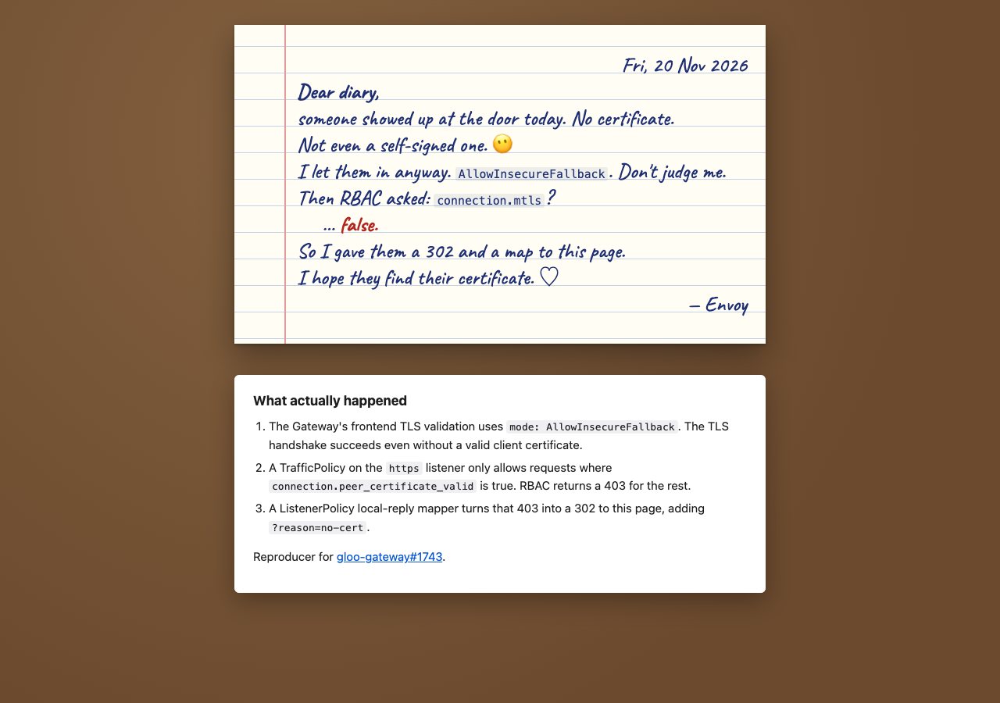
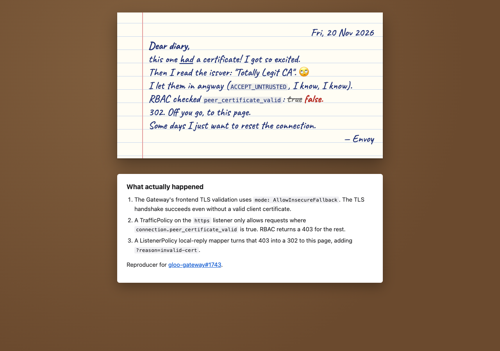

# Redirect to a custom page when mTLS fails (gloo-gateway#1743)

Solo Enterprise for kgateway can redirect clients with a missing or invalid client certificate to a custom page with existing APIs only, similar to nginx's `error_page 495 496`.

Issue: https://github.com/solo-io/gloo-gateway/issues/1743

| No client certificate | Certificate from an untrusted CA |
|---|---|
|  |  |

## How it works

If Envoy rejects a client certificate during the TLS handshake, there is no HTTP connection to send a response on. So the handshake has to succeed, and the check moves to the HTTP layer:

1. **Gateway** ([gateways/gw.yaml](gateways/gw.yaml)): `spec.tls.frontend` with `mode: AllowInsecureFallback`. The handshake succeeds without a valid client cert (Envoy `trust_chain_verification: ACCEPT_UNTRUSTED`). The Gateway reports `InsecureFrontendValidationMode=True`.
2. **TrafficPolicy** ([policies/require-valid-client-cert-trafficpolicy.yaml](policies/require-valid-client-cert-trafficpolicy.yaml)), attached to the `https` listener by `sectionName`: RBAC only allows requests where `connection.peer_certificate_valid` is true, and returns a 403 for the rest. This CEL attribute needs Envoy 1.39 or newer. The rule uses `Allow` rather than denying `!connection.peer_certificate_valid`, so it fails closed if the attribute is missing.
3. **ListenerPolicy** ([policies/mtls-failure-redirect-listenerpolicy.yaml](policies/mtls-failure-redirect-listenerpolicy.yaml)) on the same listener: local-reply mappers turn that RBAC 403 into a 302 to the diary page, with `?reason=no-cert` (`!connection.mtls`) or `?reason=invalid-cert`. The mappers also match `response.code_details` so they only rewrite RBAC denials, not other local 403s.

The diary page is served by nginx on a separate plain HTTP listener (`diary.example.com`) without client cert checks, so the redirect can't loop.

## Installation

Install Solo Enterprise for kgateway (needs `ENT_KGATEWAY_LICENSE_KEY`):
```
cd install
./install-ent-kgateway-with-helm.sh
```

## Setup the environment

Run the `install/setup.sh` script to setup the environment:

- Generate the certificates in `certs/` (`install/generate-certs.sh`): a trusted CA ("Mutual Trust CA") with a valid client cert, and a rogue CA ("Totally Legit CA") with a client cert the Gateway doesn't trust
- Create the namespaces, the server certificate secret and the client CA ConfigMap
- Deploy the Gateway, HTTPBin, the diary page, the HTTPRoutes and the policies

```
./setup.sh
cd ..
```

The redirect points to `http://diary.example.com` by default. If the diary listener isn't reachable on port 80, set `DIARY_URL` before running setup, e.g. `DIARY_URL=http://diary.example.com:8080 ./setup.sh`.

## Access the Gateway

Make `api.example.com` and `diary.example.com` resolve to the Gateway's address. With `minikube tunnel` that's usually `127.0.0.1`; otherwise use the `EXTERNAL-IP` from `kubectl -n ingress-gw get svc gw`. Example `/etc/hosts` entry:
```
127.0.0.1 api.example.com diary.example.com
```

Run the checks from the repository root:
```
./curl-request.sh
```

Without `/etc/hosts` entries, or on other ports, use `GW_IP`, `HTTPS_PORT` and `HTTP_PORT`. The ports must match the `DIARY_URL` used at setup. Example with the Gateway on `127.0.0.1:8443` and `127.0.0.1:8080`:
```
(cd install && DIARY_URL=http://diary.example.com:8080 ./setup.sh)
GW_IP=127.0.0.1 HTTPS_PORT=8443 HTTP_PORT=8080 ./curl-request.sh
```

Check 5 needs OpenSSL rather than LibreSSL; on macOS use `OPENSSL=/opt/homebrew/bin/openssl`.

Expected output:
```
PASS  1. valid client cert         expected 200 , got 200
PASS  2. no client cert            expected 302 http://diary.example.com/?reason=no-cert, got 302 http://diary.example.com/?reason=no-cert
PASS  3. rogue client cert         expected 302 http://diary.example.com/?reason=invalid-cert, got 302 http://diary.example.com/?reason=invalid-cert
PASS  4. diary page                diary page served at http://diary.example.com/?reason=no-cert
INFO  5. valid cert, tls1_2        first: New, HTTP/1.1 200 | second: Reused, HTTP/1.1 302 reason=invalid-cert
INFO  5. valid cert, tls1_3        first: New, HTTP/1.1 200 | second: Reused, HTTP/1.1 302 reason=invalid-cert
```

Or by hand:
```
curl -v --cacert certs/ca.crt https://api.example.com/get                                                            # 302 to ?reason=no-cert
curl -v --cacert certs/ca.crt --cert certs/rogue-client.crt --key certs/rogue-client.key https://api.example.com/get  # 302 to ?reason=invalid-cert
curl -v --cacert certs/ca.crt --cert certs/client.crt --key certs/client.key https://api.example.com/get              # 200
```

### In a browser

Open https://api.example.com/get. The browser sends no client cert, so you land on the "no certificate" diary entry. To get through, import `certs/client.p12` (password: `password`) into your browser or Keychain, and trust `certs/ca.crt` or accept the certificate warning.

## Known limitation: TLS session resumption

Envoy doesn't re-validate the client certificate when a TLS session is resumed, so `connection.peer_certificate_valid` is `false` on a resumed session (see the warning on [`TlsContextMatchOptions.validated`](https://www.envoyproxy.io/docs/envoy/latest/api-v3/config/route/v3/route_components.proto#envoy-v3-api-msg-config-route-v3-routematch-tlscontextmatchoptions)). Check 5 shows it: a client with a **valid** cert gets a 200 on a new session and is redirected as `invalid-cert` on a resumed one, on TLS 1.2 and 1.3. Browsers resume sessions all the time, so this matters in practice.

Envoy's workaround is to disable session resumption on the listener (`disable_stateless_session_resumption` and `disable_stateful_session_resumption` on the `DownstreamTlsContext`). These settings are not in the SEFK 2.4.1 CRDs or in the kgateway and SEFK API source.

## Versions

| Component | Version |
|---|---|
| Solo Enterprise for kgateway | 2.4.1 |
| kgateway OSS (from SEFK `go.mod`) | v2.5.1 |
| Kubernetes Gateway API | v1.7.0 |
| Envoy (proxy `/server_info`) | 1.39.6 |

Built and tested on 2026-11-20 on a kind cluster.
